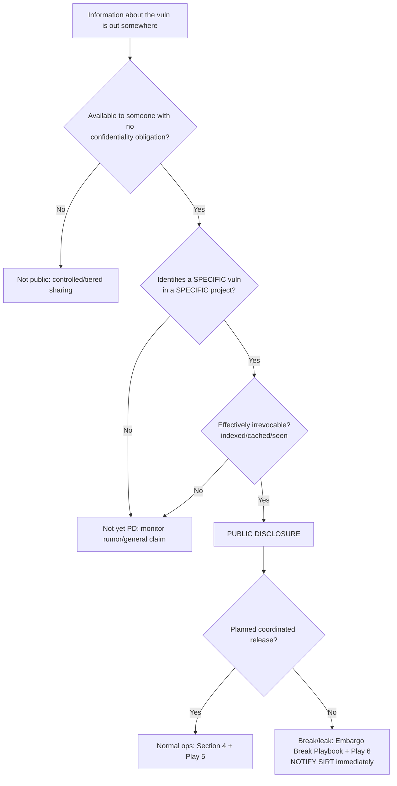

# Public Disclosure Guidelines

**Type:** Guidelines
**Approver:** SIRT Director
**Formerly titled:** What Counts as Public Disclosure — Process & Guidelines
**Owner:** Akrites SIRT
**Status:** Draft — for Akrites SIRT review
**Tracking:** [Akrites-Foundation/SIRT #23](https://github.com/Akrites-Foundation/SIRT/issues/23)
**Audience:** Akrites members, WGs, SIRT staff, and ecosystem participants
**Companion docs:** [Embargo Break Playbook](../playbooks/embargo-break-playbook.md), [Communications Playbook](../playbooks/communications-playbook.md) (Play 5 public disclosure, Play 6 embargo break), [Embargo Handling Guidelines](embargo-handling-guidelines.md), [Attribution and AI-Use Disclosure Policy](../policies/attribution-and-ai-use-disclosure-policy.md)

> Spelling standard: **Akrites** (Akrites Foundation, Akrites SIRT). "OSS-SIRT" is a synonym.

## Purpose (per issue #23)

Participants need a shared, unambiguous understanding of **when a vulnerability moves from being
coordinated privately (under embargo or another confidentiality arrangement) to being public
knowledge**, and **what to do when that happens** — whether the transition is planned (normal
coordinated disclosure) or unplanned (a leak or embargo break).

This document provides a definition and bright-line test for public disclosure, and the normal-operations
checklist. Unplanned disclosure (a leak or embargo break) is handled in the
[Embargo Break Playbook](../playbooks/embargo-break-playbook.md).

---

## 1. Definitions

- **Public Disclosure (PD):** the point at which meaningful information about a vulnerability becomes
  available to the general public *without* an access restriction or confidentiality obligation.
  PD can be **intentional** (our coordinated release) or **unintentional** (a leak/break). Once
  information is genuinely public, it is public regardless of how it got there.
- **Embargo / confidentiality arrangement:** an agreement that named parties will hold vulnerability
  information privately until an agreed time or trigger. Default proposed upstream embargo is **15 business days (bd)** from owner hand-off (targeting total time to PD of ≤ 17 bd Low/Med, ≤ 21 bd High, ≤ 24 bd Critical), negotiable and deferring to upstream (see Embargo Handling Guidelines).
- **PD date (Coordinated Release Date, CRD):** the pre-agreed date/time for intentional PD, set when the fix
  is available and an identifier is assigned. Other Akrites documents call this the PD date.
- **Tiered / read-in sharing:** sharing with specific trusted parties under a confidentiality
  obligation (TLP:RED, TLP:AMBER+STRICT or TLP:AMBER, per CVD Policy §8). This is **not** public disclosure — it is a controlled disclosure
  *boundary*, distinct from the public boundary.
- **Disclosure boundary vs. tier:** a *tier* is who is read in; a *boundary* is the line between
  confidential and public. Crossing the public boundary is PD; moving between tiers is not.
- **Silent patch:** a fix shipped publicly without describing the security issue. Because the
  vulnerability is often derivable from the diff, this is treated as a **partial public disclosure**
  (see §3.3).
- **Reasonably public / "already out":** information that is publicly reproducible or already posted
  such that it can no longer be treated as secret (e.g., a fix commit is live, a third party has
  published, or the issue is trivially rediscoverable — see §3.4).

---

## 2. The bright-line test

> **A vulnerability is publicly disclosed when specific information about it is available to any
> member of the public who did not agree to keep it confidential.  Reflect upon the possibility
> that a knowledgeable adversary could develop a working exploit from this.**

Apply three questions:

1. **Availability** — can someone outside the read-in/embargo circle obtain the information without
   a confidentiality obligation? (public URL, public repo, public list, media, talk, etc.)
2. **Specificity** — does what's available identify a *specific* vulnerability in a *specific*
   project (not just a general capability or rumor)? A fix commit or a CVE record clears this bar;
   a vague "we found bugs" post usually does not.
3. **Irrevocability** — is it effectively impossible to put back? (Even if deleted, was it indexed,
   cached, mirrored, or seen?)

If **all three** are yes, treat it as public. If in doubt, escalate to the SIRT — do not decide
alone.

---

## 3. What counts, what doesn't, and the edge cases

### 3.1 Counts as public disclosure

- Upstream publishes an advisory, release notes, or changelog naming/implying the security issue.
- A **CVE or other identifier record** (CVE-LIST, EUVD, OSV, GHSA) goes public.
- A **public fix commit, PR, or issue** that reveals or implies the vulnerability.
- A public **PoC/exploit**, blog post, mailing-list message, social post, or conference talk that
  describes the specific issue.
- **Independent third-party** public discovery/publication of the same issue.
- **Media reporting** with enough specificity to identify the vulnerability.

### 3.2 Does NOT count as public disclosure

- Read-in / tiered sharing with trusted parties under confidentiality (TLP:RED, TLP:AMBER+STRICT or TLP:AMBER, per CVD Policy §8).
- Sharing the disclosure packet with the maintainer or a coordinator under embargo.
- Internal Akrites case material, dashboards, or member-only notices that omit specifics.
- General awareness notices to members that give only a category and severity band (Play 4).
- A vague public statement that a class of bugs exists, without identifying the project/vuln.

### 3.3 Silent patches (partial disclosure)

A public fix without a security description still exposes the vulnerability to anyone who reads the
diff. Treat as **partial public disclosure**: the clock effectively starts, and the SIRT should move
to complete the record (identifier, advisory, machine-readable data) promptly so consumers aren't
left guessing. Coordinate with the maintainer on describing the issue.

### 3.4 "If we found it, others can" (LLM/fuzzer-discoverable)

Something found with a public LLM or fuzzer is not treated as a secret in the same way as a privately held finding. Under the CVD Policy §8 and the Embargo Handling Guidelines §4.3, a report developed with public AI tooling has no embargo available and is handled on an accelerated, assume-exposed basis. That rule concerns embargo eligibility. It does not mean the vulnerability has been publicly disclosed: PD still requires that specific information has actually been made public (§2). Use reproducibility when weighing timelines and acceleration, not as a definition of PD.

### 3.5 Partial vs. full exposure

Distinguish what actually became public: **existence only** (a vuln exists in X) vs. **partial**
(some detail) vs. **full** (details + reproducer/exploit). This distinction drives the break response
in the [Embargo Break Playbook](../playbooks/embargo-break-playbook.md) — not every exposure is a full disclosure requiring immediate acceleration.

---

## 4. Normal operations — coordinated public disclosure

This is the planned, intentional crossing of the public boundary on the Coordinated Release Date.

### 4.1 Preconditions (all should be true before CRD)

- **Identifier assigned.** Nothing is published without a CVE (or equivalent) identifier.
- **Fix or mitigation available.** A fixed version, fixed commit, and/or deployable
  workaround/mitigation exists. If the full fix isn't ready in time, mitigations are shared rather
  than slipping silently.
- **Maintainer alignment.** The maintainer has set (or agreed to) the final fix and PD date; we
  defer to upstream where they have a process.
- **Machine-readable data ready.** An OSV record (and CSAF/VEX where the SIRT publishes them), precise affected/fixed versions
  (tested), and references prepared alongside the human-readable advisory.
- **Attribution confirmed.** Finder acknowledgement preference recorded (see attribution doc).
- **Tiered obligations satisfied.** Any Tier 2+ pre-positioning is complete.

### 4.2 The moment PD occurs

PD is the moment the coordinated collateral is published to a public channel (Akrites website,
GHSA/OSV → CVE-LIST/EUVD, VEX feed) and the member notice/SIREN fires. From that instant the issue
is public and TLP:CLEAR. Execute Play 5 for the announcement mechanics.

### 4.3 Pre-PD readiness checklist

```
Coordinated PD readiness — {tracking-id}
[ ] Identifier assigned and reservable → public
[ ] Fixed version / fixed commit confirmed  (or mitigation ready)
[ ] Maintainer agreed fix + date
[ ] Affected/fixed versions tested and precise
[ ] OSV record staged (CSAF VEX where applicable)
[ ] CVSS vector (not just score) prepared; deviation notice if scores conflict
[ ] Acknowledgement block finalized (finder preference)
[ ] Member notice + SIREN drafted
[ ] References assembled (advisory, patch, project links)
[ ] First-report date included (published unless the Finder objects)
[ ] Go/no-go owner and time confirmed
```

---

## 5. Is it public disclosure? (flowchart)



---

## 6. Decisions (2026-11-10)

Decided by the SIRT Director under the document approval rules (decision D2):

- **PD definition and bright-line test** (§1–§2) are adopted. Key terms are to be added to the [Glossary](../reference/glossary.md).
- **Silent patches** are treated as partial public disclosure, with the follow-up obligation in §3.3.
- **"Reproducible ≠ public"** (§3.4): reproducibility weighs on timelines and acceleration, but does not by itself mean PD.
- **First-report date** is published in advisories unless the Finder objects (§4.3).

## 7. Cross-references

- Public disclosure mechanics: `communications-playbook.md` **Play 5**.
- Unplanned disclosure (leaks and embargo breaks): [Embargo Break Playbook](../playbooks/embargo-break-playbook.md).
- Embargo break comms templates: `communications-playbook.md` **Play 6**.
- Read-in finder updates / postmortem: **Play 3**, **Play 18**.
- Embargo windows and extensions: `embargo-handling-guidelines.md`.
- Attribution at PD: [Attribution and AI-Use Disclosure Policy](../policies/attribution-and-ai-use-disclosure-policy.md).

