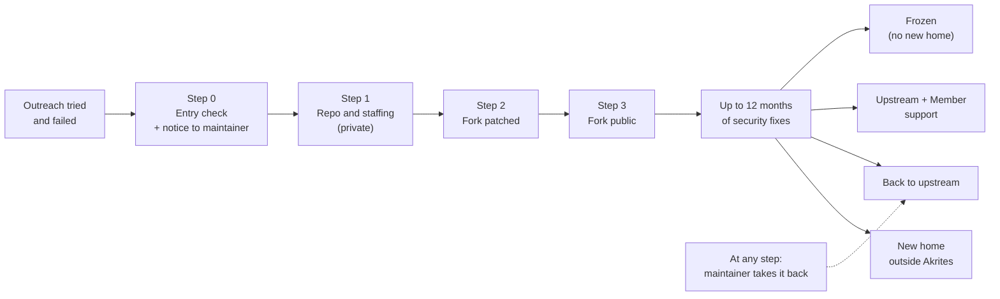
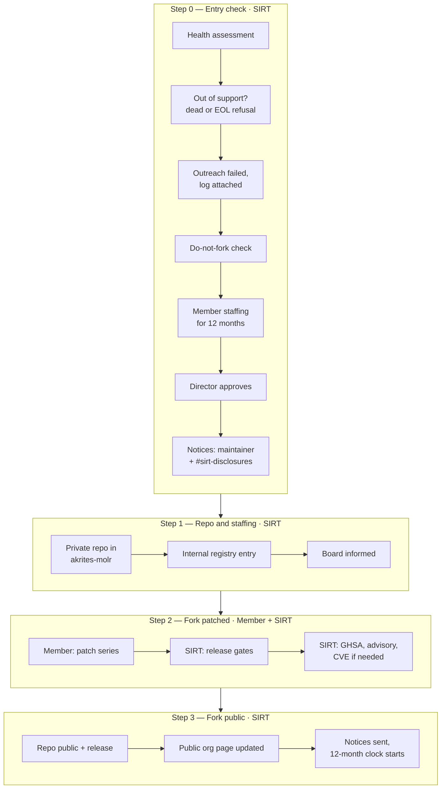
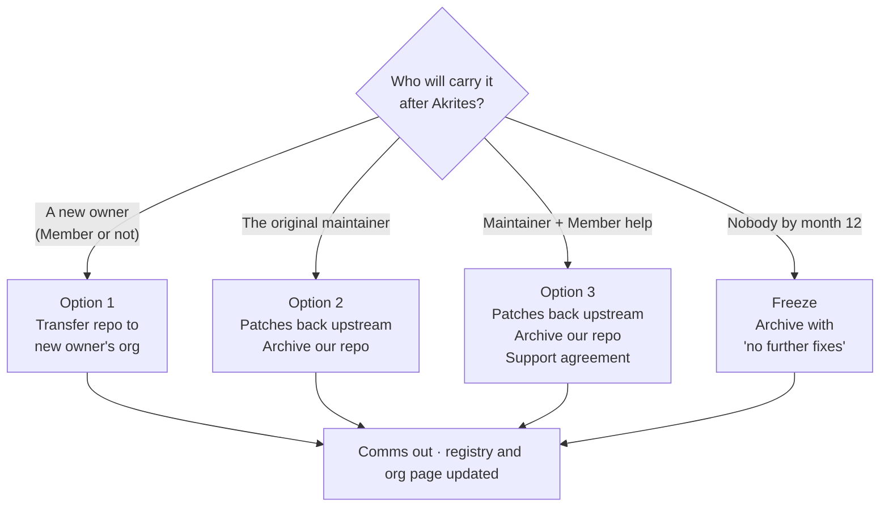

# Akrites SIRT — MoLR Guidelines and Procedures

**Owner:** Akrites SIRT
**Status:** Draft — for Akrites SIRT review (v0)
**Audience:** Part A: upstream maintainers. Part B: SIRT case coordinators and Member engineers.
**Companion docs:** [Maintainer of Last Resort (MoLR) Policy](Maintainer_of_Last_Resort_Policy.md), [Upstream Engagement Guidelines](upstream-engagement-guidelines.md), [Communications Playbook](sirt-communications-playbook.md), [CVD Policy](Akrites_CVD_Policy.md), [Templates](../templates/readme.md#unresponsive-projects-and-maintainer-of-last-resort)

The [MoLR Policy](Maintainer_of_Last_Resort_Policy.md) sets the rules; this document sets the steps. Where they differ, the policy governs, and the Policy's Part I maintainer commitments always come first.

---

## The short version

When an open source project can't or won't ship a security fix, and people depend on it, an Akrites Member staffs a **temporary security-only copy** of the project in the [Akrites MoLR](https://github.com/akrites-molr) GitHub organization. We then help the project find a lasting home.

Three rules shape everything below:

| Rule | What it means |
| --- | --- |
| **Transparent** | We tell the maintainer before we start, explain why, and say what they can do about it. Every step has a template message. |
| **Two-way door** | The maintainer can take it back at any step. Our patches are always offered upstream. |
| **Not forever** | We carry security fixes for **up to 12 months**. Then the project moves to a new home, goes back upstream, or is frozen. Akrites never owns the project. |

---

# Part A — For maintainers

You are probably reading this because the Akrites SIRT emailed you about your project, or about a version of it you no longer support.

### What does this mean for me and my project?

- **Your project stays yours.** We do not take your repository, your package name, your logo, or your registry accounts. We never ask a registry to transfer a name to us.
- **We make a separate, clearly labelled copy** in the [Akrites MoLR](https://github.com/akrites-molr) organization. Its README says it is not the official project and links back to you.
- **It carries security fixes only**, plus whatever is needed to keep it building. No features, no redesigns.
- **Every patch is offered back to you** as a pull request or patch file, so you can review and merge it whenever you like.
- **It is temporary.** We carry fixes for up to 12 months. After that the copy moves to a new home, comes back to you, or is frozen with a "no further fixes" notice.
- **If only an old version is affected** (for example a branch you've declared end-of-life), we copy and patch only that version and point users to your supported releases.

### Why are you doing this?

- **People are exposed.** A security issue affects software that others depend on, and no fix is available for the affected version.
- **We tried to reach you first.** Before this process starts, we either made repeated attempts over at least 90 days and got no answer, or you told us the affected version is end-of-life and won't be patched. Our first message lists every attempt we made, with dates.
- **Nobody else stepped up.** We also asked distributions and downstream projects whether they would carry the fix. They declined.
- **It's a last resort.** We would much rather help you ship the fix yourself, and that offer always stands.

### OK, what can I do?

| If you want to… | Do this | What happens |
| --- | --- | --- |
| **Fix it yourself or take it back** | Reply to our email, or merge or comment on our patch PRs | We stop work on our copy, hand you every patch and test, point users back to your releases, and archive our copy. No conditions, no questions. |
| **Have help instead** | Tell us you'd like support | We can agree a time-limited arrangement where an Akrites Member helps you ship security fixes in your own project. |
| **Disagree with the finding** | Reply with your reasoning | We discuss it on the merits. If you convince us, we close the case. If we still publish, you can have your reasoning printed word for word in the advisory. |
| **Stop us from making a copy** | Add a "do not fork" preference to your `SECURITY.md`, or tell us | We honor it. The only exception is critical infrastructure that many others depend on, and then only after a decision by the SIRT Director, which we tell you about in advance. |
| **Suggest who should take over** | Tell us who | We pass it on. Akrites does not choose or approve your successor, but we can transfer our copy to whoever the community settles on. |
| **Do nothing** | Nothing | We carry security fixes for up to 12 months, keep offering them to you, then hand over or freeze our copy. |

**What we will never do:** take your package name, publish under your name or namespace, unpublish releases people rely on, or ask you to justify an absence. Full list: [MoLR Policy, Part I](Maintainer_of_Last_Resort_Policy.md#part-i-plain-language-maintainer-commitments).

**Reach us:** reply to our email, or write to **SIRT@akrites.dev** with your project name.

---

# Part B — For the SIRT

### Roles

| Role | Does |
| --- | --- |
| **SIRT case coordinator** | Owns the case issue, runs the contact ladder, sends every notice, keeps the registry current. |
| **Staffing Member** | An Akrites Member that provides a named engineer and a backup for 12 months to patch and maintain the fork. |
| **SIRT Director** | Approves the engagement and informs the Governing Board. |
| **Publishers** | Two people who jointly publish each release under two-person control. |

Each engagement has **one case issue** in [`SIRT-private`](https://github.com/Akrites-Foundation/SIRT-private), opened from the [MoLR case issue template](<../templates/MoLR decision record .md>). The issue is the record: every checkbox, decision, and notice goes there.

## How a case gets here

MoLR only starts after normal coordinated disclosure has failed. Two routes lead here.

1. **Unresponsive or abandoned project.** Run the contact ladder in [Policy Part II §3.1](Maintainer_of_Last_Resort_Policy.md#31-disclosure-clock-contact--escalation) and log every attempt in the [contact attempt log](../templates/Contact_attempt_log.md). The advisory, VEX, and source patch publish on the disclosure clock as usual. MoLR becomes possible only after the abandonment floor in [Policy Part I §4](Maintainer_of_Last_Resort_Policy.md#4-90-day-silence-floor). Any sign of life resets it.
2. **End-of-life refusal.** The maintainer declined to patch an affected branch because it is end-of-life, doesn't dispute the vulnerability, and has fixed it in supported versions. Record their answer in the [Maintainer non-fix record](<../templates/Maintainer non-fix record .md>) and offer them the verbatim rationale.

A disputed finding or a WONTFIX on a supported version **never** leads here ([Policy Part II §4](Maintainer_of_Last_Resort_Policy.md#4-scenario-decision-matrix)). Handle it with an advisory, VEX, and mitigations. Communications: Plays 10, 14 and 17 in the [Communications Playbook](sirt-communications-playbook.md).

## Step 0 — Entry check `[SIRT]`

Open the case issue in `SIRT-private` and work through its Step 0 checklist. Do not create anything until every box is ticked.

1. **Project health assessment.** Fill in the checklist in the case issue: last commit, last release, maintainer activity, `SECURITY.md`, license, dependents and criticality.
2. **Out of support.** Either the project is unresponsive past the abandonment floor (route 1), or the affected version is end-of-life by the maintainer's own statement (route 2).
3. **Outreach tried and failed.** Link the contact attempt log (route 1) or the non-fix record (route 2). Confirm distributions and downstream projects were asked to carry the fix and declined.
4. **Policy entry test.** Confirm the remaining criteria in [Policy Part II §5.1](Maintainer_of_Last_Resort_Policy.md#51-mandatory-entry-test-all-must-hold): criticality, a license that permits redistribution, a bounded patch series, and a free capacity slot.
5. **"Do not fork" check.** Look at the project's `SECURITY.md` and our records. If a "do not fork" preference exists, stop, unless the SIRT Director records a critical-infrastructure override in the issue. If there is an override, the maintainer is told before anything is created.
6. **Member staffing.** A Member commits a **named engineer and a backup** for 12 months. Both are read in under the [Read-In Policy](Akrites-Read-In-Policy.md). Record the commitment in the case issue. It stays internal: publicly, engineers appear only by GitHub handle, and the Member company is never named.
7. **Conflicts.** Record any dependency the staffing Member has on the package. That is allowed, but that Member can't approve the engagement or sign off its own releases.
8. **SIRT Director approves** in the case issue.
9. **Send the notices** (templates in [MoLR communications](../templates/molr-communications.md)):
   - **M1 — Engagement notice** to the maintainer, at least **14 days before Step 3**, at every address in the contact log.
   - **S1 — MoLR engagement starting** in `#sirt-disclosures`.

## Step 1 — Repo and staffing in place `[SIRT]`

1. **Create a private repository** in [`akrites-molr`](https://github.com/akrites-molr). Use a fresh repository seeded from the pinned upstream commit, not a GitHub fork, so it doesn't inherit upstream's settings. Name it `<project>-molr`.
2. **Lock it down:** add the Member engineers by GitHub handle, protect branches, require signed commits, and set up two-person publish control.
3. **Add the internal registry entry** in `SIRT-private` ([row format](../templates/molr-communications.md#registry-entries)): project, affected versions, case issue, staffing Member, start date, planned end date, status `Preparing`.
4. **Inform the Board** with notice **B1**.

## Step 2 — Fork is patched

1. `[Member]` **Patch series on the pinned commit.** Security fixes only, plus build and toolchain changes needed to produce a signed build. Library source outside the patches and the public API must not change ([artifact rules](#artifact-and-release-gates)).
2. `[Member]` **Triage upstream's open backlog for security issues.** Carry security-relevant PRs and issues into the fork. List everything else in the case issue as a hand-over note for the next home. Don't fix it.
3. `[SIRT]` **Release gates.** Every gate in [Artifact and release gates](#artifact-and-release-gates) passes before anything is published.
4. `[SIRT]` **Advisories.** Publish a GitHub Security Advisory (GHSA) on the MoLR repo. Update the existing advisory, OSV, and VEX records to point to the fixed release. Request a CVE through the Akrites CNA if one doesn't exist yet.

## Step 3 — Fork is made public `[SIRT]`

1. **Make the repository public** with the [README header](../templates/molr-communications.md#readme-header) at the top. Issues are open for patch regressions only. PRs are closed except from Member engineers.
2. **Release.** Publish a signed, tagged source release on GitHub. Publish to a package registry only if the case issue records it, and then only under an Akrites-controlled name, never the original ([Policy Part I §3](Maintainer_of_Last_Resort_Policy.md#3-absolute-wont-do-boundaries)).
3. **Offer every patch upstream** as a PR or patch file on the original project.
4. **Route downstream:** OSV and VEX pointers, distribution security teams, and intermediate maintainers ([Policy Part III §3](Maintainer_of_Last_Resort_Policy.md#3-routing-without-taking-namespaces)).
5. **Update the public org page** (`akrites-molr/.github/profile/README.md`) with the project, the affected versions, and the planned end date. Only public engagements are listed there. Never describe a project as unpatched.
6. **Update the internal registry** to status `Active`, and record the start and end dates. The 12-month clock starts at this first release ([Policy Part II §6](Maintainer_of_Last_Resort_Policy.md#6-limits-of-a-molr-engagement)).
7. **Send the notices:** **M2 — Fork is public** to the maintainer, and **S2 — MoLR public disclosure** in `#sirt-disclosures`.

## During the 12 months

- **New vulnerability in the same package:** handle it as Step 2 inside the same repo, with the SIRT Director's approval recorded in the case issue.
- **The staffing Member withdraws:** the SIRT has 30 days to find another Member. If none is found, go straight to [Freeze](#not-forever-month-12).
- **By month 9:** send **M3 — Your options** to the maintainer and start the home search below.

## Finding a new home

The repo never stays in `akrites-molr` after the engagement ends. That org only holds active MoLR engagements.

**Option 1 — A new owner carries it (Member-staffed or not).** This creates a new maintainer of last resort outside Akrites, which is the goal.
1. Transfer the repository to the new owner's GitHub organization when they ask for it. This is a **transfer on request, not an appointment**: Akrites does not select or approve successors ([Policy Part I §3](Maintainer_of_Last_Resort_Policy.md#3-absolute-wont-do-boundaries)). We can share our recommended checks (identity, contribution history, signed commits, staged co-maintenance; see the [stewardship records](../templates/stewardship-records.md)).
2. Send **M4 — New home** to the original maintainer, and **S3** in `#sirt-disclosures`.
3. Update the advisories to point to the new location. Move the registry and org-page entries to `Moved`.

**Option 2 — Upstream takes it back.**
1. Make sure every patch has been offered upstream and merged or handed over.
2. Archive our repository read-only, with a README pointing to upstream's releases.
3. Send **M4**, **S3**, and update the advisories. Set registry and org page to `Returned`.

**Option 3 — Upstream and a Member share the work.**
1. Move the patches back upstream and archive our repository, as in Option 2.
2. Record a written, time-limited support agreement between Akrites, the Member, and the maintainer in the case issue: who helps, with what, until when.
3. Send **M4**, **S3**, and update the advisories. Set registry and org page to `Returned`.

## Not forever: month 12

If no home is found:
1. Send **M5 — Freeze notice** to the maintainer, distributions, and downstream parties at least **30 days before** the end date.
2. At the end date, **freeze**: archive the repository read-only and add a "no further fixes" notice to the README. Releases stay published, signed, and immutable. Never unpublish, delete, or yank ([Policy Part III §2](Maintainer_of_Last_Resort_Policy.md#2-freeze-on-wind-down)).
3. Send **S3**, and set registry and org page to `Frozen`. New vulnerabilities in the package are then handled with advisories, VEX, and mitigations only.

## The two-way door

The engagement and the repo can be reversed at every step. The security record can't: advisories, CVEs, and published releases stay up, because people rely on them.

| At this point | To reverse it | What stays |
| --- | --- | --- |
| **Step 0** (notice sent) | Close the case issue. Tell the maintainer and `#sirt-disclosures`. | Nothing new beyond the existing advisory. |
| **Step 1** (private repo) | Delete the private repo. Close the registry entry. | Nothing public. |
| **Step 2** (patched, private) | Send the patches upstream, then delete the private repo. | Any advisory updates already published. |
| **Step 3 and after** (public) | Follow Option 2 or 3: patches upstream, repo archived, users redirected. | The releases, GHSA, and CVE stay published, marked deprecated with a pointer upstream if the maintainer asks. |

## When the maintainer returns

Any activity by the maintainer's verified identity hands control back to them, at any step.

1. **Stop** all release work on our copy.
2. **Hand over** every patch, test, and advisory context, with no conditions.
3. **Let them choose:** Option 2 (take it all back) or Option 3 (with Member help). Send **M6 — Welcome back**.
4. **Redirect** users to their releases through the advisory, OSV, and VEX records. If they ask, mark our release deprecated; it stays published.
5. **Record** the end date and reason in the case issue and registry.

---

## Artifact and release gates

- **Structure:** a clean build of `(frozen upstream commit + N security patches)`.
- **Scope:** build configuration and toolchains may change to produce a signed build. Library source outside the patch series and the public API may not.
- **Naming and versioning:** never the original project's name or logo as the release identity. Version strings must not shadow upstream versions.
- **Integrity:** clean-room build, signed commits and artifacts with per-engagement keys, SLSA build provenance, and two-person publish control.
- **Correctness:** the upstream test suite passes, a sample of downstream consumer tests passes, the public API diff against the pinned commit is empty, and two named human reviewers sign off, disclosing any AI assistance ([AI-Use Disclosure Policy](ai-use-disclosure.md)).

## Successor search

Akrites helps a project's community find a new home through targeted outreach to distributions, dependent projects, foundations, Members, and past contributors. It never broadcasts that a package is unmaintained, and it never selects or approves the successor. Record outreach in the [stewardship records](../templates/stewardship-records.md).

## Templates

- [MoLR case issue template](<../templates/MoLR decision record .md>) — one issue per engagement, opened in `SIRT-private`
- [Contact attempt log](../templates/Contact_attempt_log.md) — every outreach attempt
- [Maintainer non-fix record](<../templates/Maintainer non-fix record .md>) — end-of-life refusals
- [MoLR communications](../templates/molr-communications.md) — maintainer emails (M1–M6), `#sirt-disclosures` notices (S1–S3), Board notice (B1), README header, registry entries
- [Stewardship records](../templates/stewardship-records.md) — successor outreach

## Open items

- **Capacity cap:** the maximum number of concurrent MoLR engagements (Policy Part II §5.1, criterion 5).
- **Criticality threshold:** the published metric and threshold (Policy Part II §5.1, criterion 2).
- **Akrites registry namespace per ecosystem** (npm, PyPI, Maven Central, crates.io, and others).
- **Per-engagement signing keys:** generation, storage, and retirement.
- **Notice periods:** 14 days before Step 3 (M1) and 30 days before a freeze (M5) are proposed here and need confirming.
- **Repeat engagements:** whether a package may have a second engagement after a freeze, and who approves it.
