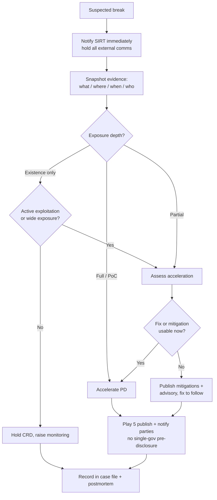

# Embargo Break Playbook

**Type:** Playbook
**Owner:** Akrites SIRT
**Approver:** SIRT Director
**Status:** Draft — for Akrites SIRT review
**Formerly titled:** What Counts as Public Disclosure, §5–6
**Tracking:** [Akrites-Foundation/SIRT #23](https://github.com/Akrites-Foundation/SIRT/issues/23)
**Audience:** Everyone who might discover a break (members, WG members, SMEs, maintainers); SIRT staff and coordinators who respond
**Trigger:** Any suspected or actual crossing of the public boundary that was not the coordinated release
**Related:** [Public Disclosure Guidelines](../guidelines/public-disclosure-guidelines.md) (what counts as public disclosure, and the planned release), [Communications Playbook](communications-playbook.md) (Plays 3, 5, 6, 18), [Crit-Sit Playbook](crit-sit-playbook.md), [CVD Policy](../policies/cvd-policy.md) §9 and §15

---

## 1. What a break is

A **break** is any crossing of the public boundary that was not the coordinated release: a leak,
premature publication, a third party going public, a silent patch that exposes the issue, or an
independent public discovery.

## 2. Golden rule

**The SIRT coordinates the response to any break.** Anyone — member engineer, WG member, SME, maintainer — who
discovers or suspects a break **must notify the SIRT immediately** and must **not** respond publicly
or independently. How we react depends on *what* leaked and *how*.

## 3. Detect and confirm

Sources of detection: monitoring of public repos/advisory feeds, member reports, maintainer notice,
media, social. On a suspected break, capture: what leaked, where, when, who confirmed, and a snapshot
(link + timestamp) before anything is deleted. Assume deletion does not undo exposure ([Public Disclosure Guidelines](../guidelines/public-disclosure-guidelines.md) §2, irrevocability).

## 4. Classify the break

Classify on two axes; the intersection sets the default response.

| Exposure ↓ / Origin → | Accidental (ours/partner) | Intentional / malicious | Third-party / independent |
| --- | --- | --- | --- |
| **Existence only** | Contain; monitor; usually hold CRD | Contain; monitor; assess motive | Monitor; often hold CRD |
| **Partial detail** | Assess acceleration; notify parties | Lean toward acceleration | Assess; coordinate with the third party |
| **Full detail / PoC** | Accelerate PD | Accelerate PD immediately | Accelerate PD; deconflict credit |

"Accelerate" = bring the coordinated disclosure forward (possibly to now). "Hold" = keep the planned
CRD but increase monitoring and readiness.

## 5. Decision factors for acceleration

- **Exposure depth** — existence vs. partial vs. full/PoC (the dominant factor).
- **Active exploitation or IOCs** in the wild → accelerate.
- **Fix/mitigation readiness** — can users act if we go public now? If not, publish mitigations with
  the advisory even if the full fix trails.
- **Breadth of exposure** — how many, and who, can now see it.
- **Reproducibility** — if the issue is trivially rediscoverable (public LLM/fuzzer class), secrecy
  buys little ([Public Disclosure Guidelines](../guidelines/public-disclosure-guidelines.md) §3.4).
- **Maintainer & coordinator input** — gather quickly, but the protect-users clock doesn't wait
  indefinitely.

## 6. Response procedure

1. **Notify the SIRT** (mandatory, immediate) and open/mark the case as a break. Hold all external
   comms.
2. **Internal flash** to the case team — use Play 6, Step 1. Assign a decision owner and a deadline.
3. **Assess & classify** per §4–5. Snapshot the evidence.
4. **Decide: accelerate or hold.** Decision owner is the SIRT case coordinator; escalate to the SIRT Director, who makes the
   final decision, for high-impact/critical-infra timing calls or disputes (CVD Policy §15). Inform the Governing Board of any policy deviation.
5. **Notify affected parties** — maintainer and coordinators (Play 6, Step 2), and read-in finders
   (Play 3). Balanced coordinator notice; **no single-government pre-disclosure.**
6. **If accelerating:** finalize the best-available advisory (fix or mitigation status stated
   honestly) and publish via Play 5. Fire the member notice/SIREN in parallel.
7. **If holding:** document why, raise monitoring, and confirm the CRD still stands with all parties.
8. **Record & learn:** record the break in the case file (including any upstream/partner
   mishandling for future risk weighting) and run a **blameless postmortem** (Play 18).

## 7. Roles

- **Discoverer (anyone):** notify SIRT immediately; do not act publicly.
- **SIRT:** coordinate, classify, decide accelerate/hold, own all outbound comms.
- **Maintainer:** consulted; retains authority over their fix; timing may be overridden only to
  protect users after a confirmed public break or confirmed active exploitation (CVD Policy §9).
- **Coordinators/clearinghouses:** notified in balanced fashion; may delegate their own read-ins.
- **SIRT Director:** makes the final accelerate/hold decision, including high-impact/critical-infra timing and disputes.
- **Governing Board:** informed of any policy deviation.

---

## 8. Break response flowchart

---

## 9. Decisions (2026-11-10)

Decided by the SIRT Director under the document approval rules (decision D2):

- **Break matrix and decision authority** (§4–§7): the SIRT case coordinator decides accelerate or hold; the SIRT Director makes the final decision; the Governing Board is informed of policy deviations.
- **Mandatory notification:** anyone who discovers or suspects a break must notify the SIRT immediately (§2).
